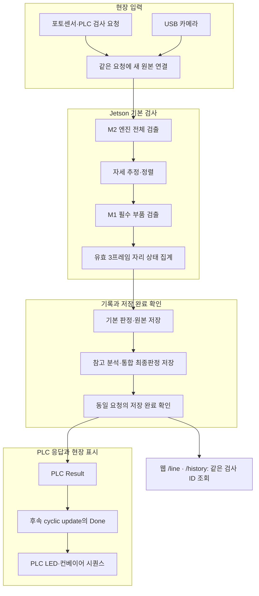

# On-Device AI 엔진 모형 조립 검사 시스템

> **새 카메라 영상 → Jetson AI 검사 → 원본·판정 저장 완료 확인 → PLC Result·Done → LED·컨베이어**를 연결하고, 같은 검사 ID로 이력을 조회하는 온디바이스 비전 검사 프로젝트

- 과정: 온디바이스 AI 기반 산업용 소프트웨어 개발 1기
- 대상 장치: **NVIDIA Jetson Orin Nano**
- 기준 운영 Release: **`engine-integrated-32c484ac6aeb07f1`**
- 평가 근거 코드 커밋: `cfaa372eece0cd6a7dc659cc316c256fb4b6af76` — 소스 확인 기준이며 현재 HEAD를 뜻하지 않음
- 현재 최종 판정 범위: **필수 부품 존재·결품 검사**
- 참고 기능: 오조립 분류는 기록·화면 표시용이며 최종 PASS/FAIL에는 반영하지 않음
- 문서: **README v1.1 · 자료 기준 2026-10-20**

### 코드와 제출 자료의 위치

| 구분 | 저장소 | 확인할 내용 |
|---|---|---|
| 실행·학습 코드 | [Engine_Assembly_Defect_Inspector](https://github.com/tmdgns104/Engine_Assembly_Defect_Inspector) | Jetson 운영 코드, 학습 도구, 모델·설정, 설치 안내 |
| 보고서·증빙 | [Engine_Assembly_Runtime_Review](https://github.com/tmdgns104/Engine_Assembly_Runtime_Review) | 문제정의·데이터·평가·통합시험 보고서, 원본 증빙, DB 검토 자료 |

본문의 코드 링크는 평가 근거 커밋에 고정했다. 제출 문서의 파일별 버전과 다운로드 경로는 산출물 저장소의 목록에서 확인한다. 두 저장소의 역할을 분리하며, 산출물 저장소를 Jetson 실행 원본으로 사용하지 않는다.

---

## 1. 프로젝트 한눈에 보기

조립 공정에서는 제품이 검사 위치에 도착했을 때 **필수 부품이 모두 장착되어 있는지 빠르게 확인하고, 판정 결과와 근거를 추적 가능하게 남기는 것**이 중요합니다.

이 프로젝트는 엔진 모형을 대상으로 다음 흐름을 실제 장비에 연결했습니다.



핵심 설계는 **클라우드가 아니라 현장의 Jetson에서 촬영·추론·판정·저장을 수행**하는 것입니다. 노트북은 개발·조회용이며, 이미 기동된 검사 서비스의 필수 실행 장치는 아닙니다.

검출 결과를 곧바로 PLC에 보내지 않습니다. 기본 결과와 원본, 통합 최종판정의 저장을 연결하고 **같은 요청의 저장 완료를 확인한 뒤 Result·Done을 전달**합니다. 웹 화면은 저장된 검사 이력을 조회하는 경로이며, 화면 조회가 PLC 전달의 선행 조건은 아닙니다. 저장·게시의 코드 연결은 7절과 [06 DB 설명서][R06] 5쪽에서 확인할 수 있습니다.

---

## 2. 확인된 주요 성과

### 모델 개발

| 항목 | M1 부품 검출 | M2 엔진 전체 검출 |
|---|---:|---:|
| 모델 | YOLO11n | YOLO11n |
| 학습 이미지 | 144장 | 144장 |
| 개발 검증 이미지 | 72장 | 72장 |
| Precision | **0.99770** | **0.96041** |
| Recall | **1.00000** | **1.00000** |
| mAP50 | **0.99500** | **0.99500** |
| mAP50–95 | **0.66473** | **0.88427** |

위 수치는 Windows 환경에서 `best.pt`를 다시 불러 수행한 E03 개발 검증 결과입니다. **M1과 M2는 고유 촬영 원본 216장을 공유**하므로 모델별 이미지 수를 더해 새 원본 432장으로 계산하지 않습니다. 개발 검증의 박스 검출 지표와 제품 단위 PASS/FAIL 결과는 구분합니다. [02 데이터셋 설명서][R02], [03 모델 평가서][R03]에 데이터 구성과 평가 조건을 제시했습니다.

### Jetson 최적화

같은 Jetson Orin Nano에서 동일 E03 72장을 사용해 PyTorch FP32와 운영 TensorRT를 비교했습니다. **4개 조건 × 3회 독립 실행 × 72장 × 실행당 5회 순환 = 4,320개 지연시간 기록**이며, 서로 다른 원본은 72장입니다.

아래 고정조건 TP·FP·FN은 confidence 0.25, class-aware NMS IoU 0.45, 정답 매칭 IoU 0.50에서 얻은 박스 검출 건수입니다.

| 항목 | M1 | M2 |
|---|---:|---:|
| PyTorch RSS 관측 최대 | 1,250.5 MiB | 1,263.8 MiB |
| TensorRT RSS 관측 최대 | 636.9 MiB | 649.7 MiB |
| **RSS 감소율** | **약 49.1%** | **약 48.6%** |
| PT / TRT 고정조건 TP·FP·FN | 192/0/0 → 192/0/0 | 72/0/0 → 72/0/0 |
| 평균 지연시간 | 29.313 → 29.022 ms | 29.480 → 30.266 ms |

이번 최적화의 대표 성과는 **프로세스 RSS 관측 최대가 약 49% 감소한 점**입니다. **평균 지연시간은 M1 약 0.99% 감소, M2 약 2.67% 증가**했습니다. 전처리·후처리를 포함한 모델별 평균 처리시간은 두 백엔드 모두 약 30 ms 수준입니다.

RSS는 라이브러리·입력 이미지를 포함한 프로세스 메모리를 100 ms 간격으로 수집한 관측값입니다. GPU 전용 메모리나 모델 파일 용량의 감소율이 아닙니다. 모델별 저장 사진 처리시간은 실제 라인의 3프레임 검사·저장·PLC 응답 전체 시간과 다릅니다. 세부 조건과 반복별 결과는 04 Benchmark 보고서에 제시했습니다.

### 실제 장비 통합시험

2026-10-18 실물 시험에서 정상 모형과 오른쪽 파이프 결품 모형을 번갈아 투입했습니다. 시험 실행본은 **`engine-integrated-4c4b935f8ab0404a`**입니다. 후속 운영본 **32c4**와는 UI 두 파일의 변경 기록으로 연결하며, 7회 결과를 32c4의 재시험 결과로 표시하지 않습니다.

| 항목 | 결과 |
|---|---:|
| 실제 완료 검사 | **7건** |
| 정상 계획 → PASS | **4 / 4** |
| 오른쪽 파이프 결품 계획 → FAIL | **3 / 3** |
| 검사당 새 원본 | **3장** |
| 저장된 원본 | **21장** |
| Result / Done / PLC 주기 완료 | **각 7건** |
| 동일 ID 상세·검색 조회 | **14 / 14 HTTP 200** |

FAIL 3건은 **시험 실패가 아니라 의도한 결품 검출 결과**입니다. 실제 시험 중 LED와 컨베이어 동작도 운영자가 확인했습니다. 이는 같은 두 모형의 반복 검사 7건이며, 통신 완료 기록과 운영자 관찰을 함께 보존했습니다. 개별 검사별 장치 동작 영상이나 모터 전기 피드백을 자동 수집한 결과와는 구분합니다.

원본 사진과 같은 ID의 상세·검색 응답은 [05 통합 테스트 결과서][R05]와 [06 DB 설명서][R06]에서 확인할 수 있습니다. 검사일은 10월 18일, 이력 GET 회수일은 10월 20일입니다.

---

## 3. 검사 대상과 판정 기준

### M1 — 필수 부품 검출

운영 클래스는 다음 3개입니다.

- `gray_pipe` — 좌/우 파이프 두 자리를 같은 클래스로 검출
- `exhaust_top`
- `symbol_module`

정상 모형에서는 `gray_pipe` 2개, `exhaust_top` 1개, `symbol_module` 1개가 기대됩니다.

### M2 — 엔진 전체 검출

- `product_envelope` 1개
- 엔진 전체 영역을 검출해 검사 대상의 위치와 Pose 처리에 사용

### 최종 판정 정책

현재 최종 판정은 **필수 부품 존재·결품**을 기준으로 합니다.

- `PASS` — 필요한 부품이 3프레임에서 일관되게 존재
- `FAIL` — 필요한 부품의 결품이 3프레임에서 일관되게 확인
- `REVIEW` — 자세·품질·가시성·프레임 일치 등으로 자동 확정이 어려움
- `ERROR` — 카메라·프로그램·저장 등 시스템 오류

오조립 분류 M3~M6는 참고 정보로 저장·표시하지만 현재 최종 PASS/FAIL에는 반영하지 않습니다.

---

## 4. 데이터와 학습 과정

학습 관련 소스는 `notebook/training/`에 보존합니다. 현재 M1·M2의 라벨 출처는 모델별 작성·검토 기록으로 구분합니다.

```text
실물 촬영·촬영 회차 및 출처 기록
    ↓
M1 부품 라벨 작성·사용자 승인 / M2 엔진 전체 라벨 작성·AI 검토
    ↓
모델별 YOLO 라벨과 이미지 대응·분할 점검
    ↓
E01·E02 학습 144장 / E03 개발 검증 72장
    ↓
YOLO11n 학습 → best.pt 개발 검증
    ↓
ONNX export → TensorRT plan build → Jetson 운영 패키지
```

### 실제 라벨 작성·검토 이력

| 구분 | 작성·검토 방법 | 연결된 기록 |
|---|---|---|
| **M1 부품 검출** | 자세별 기준 이미지 24장에서 부품 박스를 제안하고, 같은 자세·분할 내 이미지 정합으로 나머지 제안 박스를 구성. 동일 annotation SHA에 대해 사용자가 216개 이미지·라벨 세트의 확인·학습 승인을 기록 | `annotations_used.json`, `approval.json`, `approval_provenance.json` |
| **M2 엔진 전체 검출** | 같은 216장에 엔진 전체 box를 부여. AI 시각 검토 216개 제안과 box 109개 변경, 선택 버전 기록을 보존 | `dataset_pose_audit_v004.json` |

M1의 사용자 승인과 M2의 AI 검토는 서로 다른 근거입니다. M1의 승인을 M2의 사람 검수 완료로 확대하지 않습니다. 제안 생성 당시의 상태와 이후 승인 기록도 함께 보존합니다. 모델별 근거의 상세 위치는 [02 데이터셋 설명서][R02] 6·15쪽에 있습니다.

### 데이터 구성

정상, 왼쪽 파이프 결품, 오른쪽 파이프 결품, 배기 부품 결품, 문양 부품 결품, 대상 네 부품 전체 결품의 여섯 상태를 포함합니다. 각 상태는 학습 24장·개발 검증 12장입니다.

학습은 E01·E02, 개발 검증은 E03로 분리했습니다. 이미지 ID·capture ID·이미지 SHA·기록된 그룹의 train/val 교집합은 0으로 보고돼 있습니다. M1의 부품 box는 576개, M2의 엔진 전체 box는 216개입니다. 전체 대상 결품 36장의 빈 M1 라벨은 엔진 몸체가 남아 있는 부품 부재 상태를 표현합니다.

### 코드와 전체 파일의 위치

- [`notebook/training/README_KO.md`](https://github.com/tmdgns104/Engine_Assembly_Defect_Inspector/blob/cfaa372eece0cd6a7dc659cc316c256fb4b6af76/notebook/training/README_KO.md) — 수집·라벨 처리·학습 코드 안내
- [`jetson/products/README.md`](https://github.com/tmdgns104/Engine_Assembly_Defect_Inspector/blob/cfaa372eece0cd6a7dc659cc316c256fb4b6af76/jetson/products/README.md) — 운영 모델과 자산 안내
- [`dynamic_parts_005/manifest.json`](https://github.com/tmdgns104/Engine_Assembly_Defect_Inspector/blob/cfaa372eece0cd6a7dc659cc316c256fb4b6af76/jetson/products/ENGINE_Z3005_5/dynamic_parts_005/manifest.json) — M1 운영 manifest
- [`envelope_v007_fp16/manifest.json`](https://github.com/tmdgns104/Engine_Assembly_Defect_Inspector/blob/cfaa372eece0cd6a7dc659cc316c256fb4b6af76/jetson/products/ENGINE_Z3005_5/envelope_v007_fp16/manifest.json) — M2 운영 manifest

전체 학습·개발 검증 사진과 라벨은 **산출물 저장소의 `M1_M2_dataset_evidence_v002.zip`**으로 연결합니다. 모델별 폴더에는 이미지 복사본 총 432개와 라벨 TXT 432개가 있으며, 고유 촬영 원본은 216장입니다. 보호된 E04·B04 자료는 이 묶음의 범위에 포함하지 않습니다. E03는 개발 검증이며 독립 최종시험 결과가 아닙니다.

---

## 5. PT → ONNX → TensorRT 운영 모델 연결

현재 운영 모델은 학습 가중치부터 운영 plan까지 SHA-256으로 연결했습니다.

| 모델 | PT | ONNX | 운영 TensorRT |
|---|---|---|---|
| M1 | `42db1830...bf5259` | `433b16fd...9c296` | `743ce54b...bf2d6c` |
| M2 | `cf117def...0f7755` | `5cb024bb...ca830` | `c82f2658...cebf83` |

운영 TensorRT는 단순 파일 확장자 변경이 아니라, manifest에 고정된 입력·출력 계약과 전처리·후처리를 사용합니다. **M1은 FP16 + head FP32, M2는 FP16 + backbone FP32이며 입출력은 float32인 혼합정밀도 구성**입니다. 위 표의 축약값은 파일 식별용이고, 전체 SHA-256과 export·build 조건은 [03 모델 평가서][R03] 및 07 Jetson 실행·변환 절차서에 제시했습니다.

- 입력: batch 1, `640×640`
- letterbox + padding 114
- BGR → RGB
- `/255`
- class-aware NMS
- 원본 좌표 복원
- native TensorRT `execute_async_v3`

실행 코드는 backend를 명시적으로 선택하며, 운영 TensorRT 실패 시 조용히 PyTorch로 fallback하지 않습니다.

주요 코드:

- [`jetson/src/vision/detector_factory.py`](https://github.com/tmdgns104/Engine_Assembly_Defect_Inspector/blob/cfaa372eece0cd6a7dc659cc316c256fb4b6af76/jetson/src/vision/detector_factory.py)
- [`jetson/src/vision/tensorrt_native.py`](https://github.com/tmdgns104/Engine_Assembly_Defect_Inspector/blob/cfaa372eece0cd6a7dc659cc316c256fb4b6af76/jetson/src/vision/tensorrt_native.py)
- [`jetson/src/vision/tensorrt_preprocess.py`](https://github.com/tmdgns104/Engine_Assembly_Defect_Inspector/blob/cfaa372eece0cd6a7dc659cc316c256fb4b6af76/jetson/src/vision/tensorrt_preprocess.py)
- [`jetson/src/vision/tensorrt_postprocess.py`](https://github.com/tmdgns104/Engine_Assembly_Defect_Inspector/blob/cfaa372eece0cd6a7dc659cc316c256fb4b6af76/jetson/src/vision/tensorrt_postprocess.py)
- [`jetson/src/vision/engine_inspector.py`](https://github.com/tmdgns104/Engine_Assembly_Defect_Inspector/blob/cfaa372eece0cd6a7dc659cc316c256fb4b6af76/jetson/src/vision/engine_inspector.py)

---

## 6. Jetson 운영 구조

운영 경로의 중심은 다음과 같습니다.

```text
/home/jetson/oned_device_bench/
├── current/        실행 코드 / Web UI / release.json
├── assets/         TensorRT + 참고 분류 모델 / 기준 자산
├── config/         장치별 설정
├── data/           현재 검사 Journal / 원본 / Evidence
├── history/        과거 SQLite 보관본
├── envs/           GPU Python 환경
└── service/        systemd unit
```

`engine-inspector.service` 하나가 통합 서비스를 감독합니다.

`standalone_service.py`는 다음 컴포넌트를 구성합니다.

1. 카메라 Worker
2. M1/M2 검사
3. 자세 정렬과 3프레임 판정
4. SQLite Journal / Evidence
5. OpENer 기반 PLC 통신
6. `/line`, `/history` Web UI

상세 구조는 [`jetson/INTEGRATED_RUNTIME.md`](https://github.com/tmdgns104/Engine_Assembly_Defect_Inspector/blob/cfaa372eece0cd6a7dc659cc316c256fb4b6af76/jetson/INTEGRATED_RUNTIME.md)를 참고하세요.

---

## 7. PLC 연계와 저장 완료 확인

실물 통합 구성은 OMRON PLC와 OpENer cyclic I/O를 사용합니다. 기본 검사 결과와 통합 최종판정을 저장한 뒤, 같은 요청의 완료 여부를 확인하여 PLC에 게시합니다.

```text
PLC Inspection_Request 수락
    ↓
요청에 귀속된 새 유효 프레임 확보·M2/Pose/M1 검사
    ↓
3프레임 기본 판정 및 원본·표시 이미지 저장
    ↓
오조립 참고 분석과 통합 최종판정 저장
    ↓
동일 요청의 저장 성공·완료 응답 확인
    ↓
PLC Result 게시
    ↓
후속 cyclic update에서 Done
    ↓
PLC 요청 LOW 복귀·운전 조건에 따른 다음 사이클
```

### 저장과 PLC 게시를 연결하는 코드

`standalone.py`의 `_commit_and_publish()`는 같은 요청에 속한 완료 기록과 `storage_success`를 확인합니다. OPENER_CYCLIC 경로에서는 `submit_final()`로 저장을 요청하고, `_poll_final_commit()`에서 완료 응답·요청 문맥을 검사한 뒤 `_publish_committed()`를 호출합니다. [06 DB 설명서][R06] 5쪽과 07 Jetson 실행·변환 절차서가 이 순서를 설명합니다.

| 최종 판정 | PLC Result | 의미 |
|---|---|---|
| PASS | `false` / 0 | OK |
| FAIL | `true` / 1 | NG — 결품 등 판정 사유를 원장에 보존 |
| REVIEW / ERROR | `true` / 1 | NG — 재확인·시스템 오류의 원판정과 원인을 별도로 보존 |

이 표는 **같은 요청의 저장·완료 조건을 충족하여 결과를 게시하는 경로의 매핑**입니다. 저장 실패나 유효 요청 부재 시에도 일반 완료 사이클과 동일하게 Result·Done을 보낸다는 의미는 아닙니다.

저장된 PLC 프로그램은 Done과 Result에 따라 정상·결품 기억 및 LED를 연결하고, 운전 조건에서 정상·NG 모두 재이송하는 **푸셔 없는 구성**입니다. 자동 분리·배출 푸셔는 구현 범위에 포함하지 않습니다. 래더에서 확인한 기대 동작, 통신 기록, 운영자의 실제 동작 관찰은 [05 통합 테스트 결과서][R05] 8쪽에서 구분해 제시했습니다.

---

## 8. 검사 이력과 Web UI

SQLite에는 단순 PASS/FAIL만 저장하지 않고 검사 근거를 연결합니다.

예:

- inspection ID
- 촬영 시각
- 원본 frame
- 부품별 판정
- reason code
- 최종 판정
- 모델·설정 정보
- PLC cycle / event
- 저장 상태

Web:

- `/line` — 현재 라인 상태·최근 검사
- `/history` — 검색·상세 조회·CSV 내보내기

실제 7건 통합시험은 검사 ID 기준으로 원본·판정·PLC 이벤트·DB 조회를 연결했습니다. 사진은 파일 시스템에, 경로·크기·해시와 결과는 SQLite에 저장합니다. 이력 조회는 별도의 읽기 전용 연결을 사용합니다.

화면의 **몸체 정렬 0/3·분류 미실행** 표시는 해당 이력의 오조립 참고 분석 상태입니다. 기본 결품 검사·최종 FAIL·원본 3장 저장과 구분해 읽습니다. 상세 구조와 예시는 [06 DB 설명서][R06] 7~9쪽에 있습니다.

---

## 9. 다른 Jetson에서 실행

다른 Jetson에 설치할 때의 기준 문서는 [`jetson/INSTALL_OPERATING_KO.md`](https://github.com/tmdgns104/Engine_Assembly_Defect_Inspector/blob/cfaa372eece0cd6a7dc659cc316c256fb4b6af76/jetson/INSTALL_OPERATING_KO.md)입니다. 아래 코드는 **설치 입력 검증과 설치 후 점검 예시**입니다. 장치 폴더 준비, Python 환경 구성, 카메라·PLC 설정을 생략한 전체 설치 스크립트가 아닙니다.

먼저 저장소를 받습니다.

```bash
git clone https://github.com/tmdgns104/Engine_Assembly_Defect_Inspector.git
cd Engine_Assembly_Defect_Inspector
```

파일·패키지 검증:

```bash
python3.10 -B -X utf8 jetson/install_operating.py --verify
```

설치 안내에 따라 장치 폴더·`app_v1` 환경을 준비한 뒤 수행하는 점검:

```bash
~/oned_device_bench/envs/app_v1/bin/python -B -X utf8 jetson/check_operating.py
~/oned_device_bench/envs/app_v1/bin/python -B -X utf8 \
  ~/oned_device_bench/current/standalone_service.py \
  --config ~/oned_device_bench/config/standalone.json \
  --check-only
~/oned_device_bench/envs/app_v1/bin/python -B -X utf8 jetson/check_operating.py --gpu-smoke
```

> TensorRT plan은 생성 환경과 GPU/TensorRT 호환성의 영향을 받습니다. 파일 복사 성공과 실제 장비 인수시험은 구분합니다.

실제 카메라 기준 등록, PLC 계약 확인, systemd 등록과 신규 장치 실물 시험은 설치 문서의 순서대로 진행합니다.

---

## 10. 저장소 구조

```text
Engine_Assembly_Defect_Inspector/
├── jetson/                   Jetson 운영 코드·설치·모델
│   ├── apps/                 Web / edge service
│   ├── src/                  vision / runtime / control / journal
│   ├── products/             M1·M2 운영 패키지
│   └── portable/             운영본 portable 설치 입력
├── notebook/
│   ├── training/             촬영·라벨·학습·평가 소스
│   └── deployment/           배포·검증 도구
├── assets/                   참고 오조립 모델·동결 자산
├── database/                 SQLite 보관본·설명
├── docs/                     설계·결정·검증 기록
├── tasks/                    개발 Task 이력
└── hardware/                 장비·거치 구조 관련 자료
```

개발 원본은 `jetson/`과 `notebook/`입니다. 과거 `runs/`, 후보 결과, Task 자료는 개발 이력과 근거로 읽습니다.

---

## 11. 평가·검증 자료

**실행·학습 코드는 [코드 저장소](https://github.com/tmdgns104/Engine_Assembly_Defect_Inspector), 보고서와 증빙 다운로드는 [산출물 저장소](https://github.com/tmdgns104/Engine_Assembly_Runtime_Review)에서 확인합니다.**

| 문서 | 확인할 내용 | 연결되는 근거 |
|---|---|---|
| 01 문제정의서 | 현장 문제, 사용자, 입출력, 정상·이상 기준, 성공 기준 | 구현 범위와 실제 시험 결과 |
| [02 데이터셋 설명서][R02] | 수집·라벨 작성·분할·품질 점검 | `M1_M2_dataset_evidence_v002.zip`의 전체 사진·라벨 |
| [03 모델 평가서][R03] | 학습 설정, P/R/mAP, 경계 오차·추가 후보 분석 | `M1_M2_model_evaluation_evidence_v001.zip` |
| 04 Benchmark 보고서 | 동일 Jetson의 PT/TRT 지연시간·처리량·RSS·검출 성능 비교 | `M1_M2_benchmark_evidence_v001.zip`의 프로토콜·전체 측정·예측 |
| [05 통합 테스트 결과서][R05] | 정상·오른쪽 파이프 결품 7건의 검사·저장·PLC 연결 | `Engine_Integrated_Test_Evidence_v001.zip`의 원본·이벤트·조회 |
| [06 DB 구조·조회 방식][R06] | SQLite 구조, 검사 ID 추적, 읽기 전용 조회·SQL | 통합시험 증빙과 `review_kit`의 발췌 DB·조회 예시 |
| 07 Jetson 실행·변환 절차서 | 서비스 실행, 저장 후 게시, PT→ONNX→TensorRT 계보, 설치 | 평가 기준 코드·manifest·변환 기록 |
| 08 프로젝트 기획안 | 프로젝트 목표, 설계 원칙, 구현 성과, 계획 당시 역할 | 01~07 세부 보고서 |
| 09 README | 프로젝트 개요·실행·성과·자료 탐색 | 코드 저장소와 산출물 저장소 연결 |
| 10 최종 결과보고서 | 문제부터 데이터·모델·장치·DB까지의 종합 결과 | 세부 보고서와 원본 증빙 |

표의 원본 ZIP 이름은 각 보고서가 참조하는 증빙 이름입니다. 저장소에서는 제출 묶음 ZIP 안에 포함된 자료도 있으므로, 내려받을 외부 파일과 내부 원본 ZIP의 위치는 산출물 저장소의 목록·묶음 안내를 함께 확인합니다. 보고서 개정 버전과 원본 실험 증빙 버전은 별도로 관리합니다.

대용량 전체 데이터는 이 프로젝트의 학습·검증 근거이며, 샘플 그림이나 README의 요약표로 대체하지 않습니다.

---

## 12. 구현 범위와 검증 범위

확인된 성과는 검사 기능, 모델별 개발 검증, Jetson 비교 측정, 실물 연계 시험으로 나누어 해석합니다.

| 구분 | 확인한 범위 | 해석 기준 |
|---|---|---|
| 최종 검사 기능 | 필수 부품 존재·결품, 3프레임 자리 상태 집계 | 오조립 분류는 참고 정보이며 최종 PASS/FAIL에는 미반영 |
| 개발 검증 | E01·E02 학습 144장, E03 검증 72장 | E03 결과는 독립 E04 최종시험 성능이 아님 |
| 최적화 비교 | 같은 Jetson의 모델별 PT/TRT 실행, 12회·4,320개 시간 기록 | 약 30 ms는 모델별 처리시간, 약 49%는 프로세스 RSS 관측 최대의 감소 |
| 실물 통합 | 정상·오른쪽 파이프 결품의 7회 반복과 저장·Result/Done·조회 연결 | 같은 두 모형의 반복이며 다양한 결품·환경·장시간 신뢰성의 정량 검증을 포괄하지 않음 |
| 장치 반응 | 통신·요청 해제 기록과 운영자의 LED·컨베이어 동작 관찰 | 검사별 독립 동작 영상·모터 전기 피드백을 자동 수집한 결과는 아님 |
| 다른 장치 실행 | portable 설치와 check-only·GPU smoke·현장 설정 절차 | 파일 검증 성공과 신규 장치의 정상·결품 실물 인수시험은 별개 |

이 범위 안에서 **학습 모델 → Jetson 실행 → 저장 확인 → PLC 응답 → 같은 ID의 결과 조회**를 실제 코드와 측정·검사 기록으로 연결했습니다. 보호된 시험 데이터, 기존 실패 진단, 참고 분석 상태는 원자료의 범위를 유지합니다.

---

## 13. 기준 버전과 문서 경로

| 구분 | 식별 기준 |
|---|---|
| 평가 근거 코드 커밋 | `cfaa372eece0cd6a7dc659cc316c256fb4b6af76` |
| 기존 README v1.0 반영 커밋 | `6b8931aa5c6704ee0b2c6c2a120d3e097b9d9e84` — 문서 반영 기록 |
| 기준 운영 릴리스 | `engine-integrated-32c484ac6aeb07f1` |
| 기존 실물 7회 시험 실행본 | `engine-integrated-4c4b935f8ab0404a` |
| 이 파일의 문서 버전 | README v1.1 · 자료 기준 2026-10-20 |

코드 확인 커밋, README 문서 반영 커밋, 장치에 배포된 릴리스는 서로 다른 식별자입니다. README 수정만으로 런타임이 재배포되거나 과거 실물시험의 실행본이 바뀌지는 않습니다. 4c4b 시험과 후속 32c4의 연결은 [05 통합 테스트 결과서][R05] 12쪽에 제시했습니다.

| 경로 | 확인할 내용 |
|---|---|
| [Jetson 코드와 구조](https://github.com/tmdgns104/Engine_Assembly_Defect_Inspector/blob/cfaa372eece0cd6a7dc659cc316c256fb4b6af76/jetson/README.md) | 코드 읽는 순서 |
| [운영본 설치](https://github.com/tmdgns104/Engine_Assembly_Defect_Inspector/blob/cfaa372eece0cd6a7dc659cc316c256fb4b6af76/jetson/INSTALL_OPERATING_KO.md) | 새 장치 준비·환경·점검·기동 |
| [통합 Runtime](https://github.com/tmdgns104/Engine_Assembly_Defect_Inspector/blob/cfaa372eece0cd6a7dc659cc316c256fb4b6af76/jetson/INTEGRATED_RUNTIME.md) | 통합 서비스 구조 |
| [학습 과정](https://github.com/tmdgns104/Engine_Assembly_Defect_Inspector/blob/cfaa372eece0cd6a7dc659cc316c256fb4b6af76/notebook/training/README_KO.md) | 수집·라벨 처리·학습 소스 |
| [설정·이력 조회](https://github.com/tmdgns104/Engine_Assembly_Defect_Inspector/blob/cfaa372eece0cd6a7dc659cc316c256fb4b6af76/docs/CONFIGURATION_AND_HISTORY_KO.md) | 운영 설정과 검색·상세·CSV |
| [2026-10-18 운영 검증 기록](https://github.com/tmdgns104/Engine_Assembly_Defect_Inspector/blob/cfaa372eece0cd6a7dc659cc316c256fb4b6af76/docs/verification/CONFIG-UI-HISTORY-20261018.json) | 실물시험·후속 UI 변경 기록 |
| [SQLite 보관본](https://github.com/tmdgns104/Engine_Assembly_Defect_Inspector/blob/cfaa372eece0cd6a7dc659cc316c256fb4b6af76/database/README.md) | 운영 원장과 보관본의 구분 |
| [평가 보고서·증빙 목록](https://github.com/tmdgns104/Engine_Assembly_Runtime_Review) | 제출 문서별 버전과 다운로드 경로 |

---

## 14. 성과 해석 기준

이 프로젝트는 교육용 엔진 모형을 대상으로 **데이터 수집·라벨·학습·최적화·현장 검사·결과 추적**을 연결한 구현입니다.

- 개발 검증의 mAP와 실물 제품 PASS/FAIL은 서로 다른 평가 단위입니다.
- 저장 사진의 모델별 처리시간과 3프레임 검사·저장·PLC 응답 전체 시간은 구분합니다.
- 7건의 정상·결품 반복시험은 해당 조건의 구현 근거이며 장시간 신뢰성 인증이 아닙니다.
- 통신 기록, 실물 관찰, 참고 분석과 최종판정은 각 기록의 의미를 유지합니다.

**핵심 성과는 모델 검출에 그치지 않고, 검사에 사용한 원본과 판정 사유를 보존한 뒤 PLC에 전달하고 같은 ID로 다시 조회할 수 있게 만든 점입니다.**

[R02]: https://github.com/tmdgns104/Engine_Assembly_Runtime_Review/blob/main/02_%EC%97%94%EC%A7%84%EB%AA%A8%ED%98%95_%EB%8D%B0%EC%9D%B4%ED%84%B0%EC%85%8B_%EC%84%A4%EB%AA%85%EC%84%9C_v1.2.pdf
[R03]: https://github.com/tmdgns104/Engine_Assembly_Runtime_Review/blob/main/03_%EC%97%94%EC%A7%84%EB%AA%A8%ED%98%95_%EB%AA%A8%EB%8D%B8_%ED%8F%89%EA%B0%80%EC%84%9C_v1.1.pdf
[R05]: https://github.com/tmdgns104/Engine_Assembly_Runtime_Review/blob/main/05_%EC%97%94%EC%A7%84%EB%AA%A8%ED%98%95_%ED%86%B5%ED%95%A9%ED%85%8C%EC%8A%A4%ED%8A%B8_%EA%B2%B0%EA%B3%BC%EC%84%9C_v1.0.pdf
[R06]: https://github.com/tmdgns104/Engine_Assembly_Runtime_Review/blob/main/06_%EC%97%94%EC%A7%84%EB%AA%A8%ED%98%95_DB_%EA%B5%AC%EC%A1%B0%EC%99%80_%EC%A1%B0%ED%9A%8C%EB%B0%A9%EC%8B%9D_v1.0.pdf
