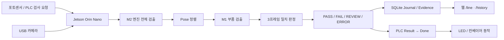

# On-Device AI 엔진 모형 조립 검사 시스템

> **카메라 → Jetson AI 검사 → PLC 결과 전달 → SQLite 이력 저장 → 웹 조회**까지 연결한 온디바이스 비전 검사 프로젝트

- 과정: 온디바이스 AI 기반 산업용 소프트웨어 개발 1기
- 대상 장치: **NVIDIA Jetson Orin Nano**
- 기준 운영 Release: **`engine-integrated-32c484ac6aeb07f1`**
- GitHub 기준: `master` / `cfaa372eece0cd6a7dc659cc316c256fb4b6af76`
- 현재 최종 판정 범위: **필수 부품 존재·결품 검사**
- 참고 기능: 오조립 분류는 기록·화면 표시용이며 최종 PASS/FAIL에는 반영하지 않음

---

## 1. 프로젝트 한눈에 보기

조립 공정에서는 제품이 검사 위치에 도착했을 때 **필수 부품이 모두 장착되어 있는지 빠르게 확인하고, 판정 결과와 근거를 추적 가능하게 남기는 것**이 중요합니다.

이 프로젝트는 엔진 모형을 대상으로 다음 흐름을 실제 장비에 연결했습니다.



핵심 설계는 **클라우드가 아니라 현장의 Jetson에서 촬영·추론·판정·저장을 수행**하는 것입니다. 노트북은 개발·조회용이며, 이미 기동된 검사 서비스의 필수 실행 장치는 아닙니다.

---

## 2. 확인된 주요 성과

### 모델 개발

| 항목 | M1 부품 검출 | M2 엔진 전체 검출 |
|---|---:|---:|
| 모델 | YOLO11n | YOLO11n |
| 학습 이미지 | 144장 | 144장 |
| 개발 검증 이미지 | 72장 | 72장 |
| Precision | **0.99770** | **0.96041** |
| Recall | **1.00000** | **1.00000** |
| mAP50 | **0.99500** | **0.99500** |
| mAP50–95 | **0.66473** | **0.88427** |

위 수치는 Windows 환경에서 `best.pt`를 다시 불러 수행한 E03 개발 검증 결과입니다. 제품 단위 PASS/FAIL 정확도와는 구분합니다.

### Jetson 최적화

같은 Jetson Orin Nano에서 동일 E03 72장을 사용해 PyTorch FP32와 운영 TensorRT를 비교했습니다.

| 항목 | M1 | M2 |
|---|---:|---:|
| PyTorch RSS 관측 최대 | 1,250.5 MiB | 1,263.8 MiB |
| TensorRT RSS 관측 최대 | 636.9 MiB | 649.7 MiB |
| **RSS 감소율** | **약 49.1%** | **약 48.6%** |
| PT / TRT 고정조건 TP·FP·FN | 192/0/0 → 192/0/0 | 72/0/0 → 72/0/0 |
| 평균 지연시간 | 29.313 → 29.022 ms | 29.480 → 30.266 ms |

이번 최적화의 가장 분명한 성과는 **실행 프로세스 메모리 절감**입니다. 전처리·후처리를 포함한 평균 처리시간은 두 백엔드 모두 약 30 ms 수준이었고, 큰 속도 가속은 확인되지 않았습니다.

### 실제 장비 통합시험

2026-10-18 실물 시험에서 정상 모형과 오른쪽 파이프 결품 모형을 번갈아 투입했습니다.

| 항목 | 결과 |
|---|---:|
| 실제 완료 검사 | **7건** |
| 정상 계획 → PASS | **4 / 4** |
| 오른쪽 파이프 결품 계획 → FAIL | **3 / 3** |
| 검사당 새 원본 | **3장** |
| 저장된 원본 | **21장** |
| Result / Done / PLC 주기 완료 | **각 7건** |
| 동일 ID 상세·검색 조회 | **14 / 14 HTTP 200** |

FAIL 3건은 **시험 실패가 아니라 의도한 결품 검출 결과**입니다. 실제 시험 중 LED와 컨베이어 동작도 운영자가 확인했습니다. 다만 검사별 독립 동작 영상과 전기적 소비 피드백은 별도 확보 대상입니다.

---

## 3. 검사 대상과 판정 기준

### M1 — 필수 부품 검출

운영 클래스는 다음 3개입니다.

- `gray_pipe` — 좌/우 파이프 두 자리를 같은 클래스로 검출
- `exhaust_top`
- `symbol_module`

정상 모형에서는 `gray_pipe` 2개, `exhaust_top` 1개, `symbol_module` 1개가 기대됩니다.

### M2 — 엔진 전체 검출

- `product_envelope` 1개
- 엔진 전체 영역을 검출해 검사 대상의 위치와 Pose 처리에 사용

### 최종 판정 정책

현재 최종 판정은 **필수 부품 존재·결품**을 기준으로 합니다.

- `PASS` — 필요한 부품이 3프레임에서 일관되게 존재
- `FAIL` — 필요한 부품의 결품이 3프레임에서 일관되게 확인
- `REVIEW` — 자세·품질·가시성·프레임 일치 등으로 자동 확정이 어려움
- `ERROR` — 카메라·프로그램·저장 등 시스템 오류

오조립 분류 M3~M6는 참고 정보로 저장·표시하지만 현재 최종 PASS/FAIL에는 반영하지 않습니다.

---

## 4. 데이터와 학습 과정

학습 과정은 `notebook/training/`에 보존합니다.

```text
실제 촬영
  ↓
촬영 검토 / provenance
  ↓
VIA 라벨링
  ↓
YOLO 변환
  ↓
train / validation 분리 검증
  ↓
YOLO11n 학습
  ↓
best.pt 평가
  ↓
ONNX export
  ↓
TensorRT plan build
  ↓
Jetson 운영 패키지
```

주요 문서:

- [`notebook/training/README_KO.md`](notebook/training/README_KO.md) — 촬영·라벨링·학습 과정
- [`jetson/products/README.md`](jetson/products/README.md) — 운영 모델과 자산
- `jetson/products/ENGINE_Z3005_5/dynamic_parts_005/manifest.json` — M1 운영 manifest
- `jetson/products/ENGINE_Z3005_5/envelope_v007_fp16/manifest.json` — M2 운영 manifest

전체 원본 학습·검증 데이터는 저장소 용량과 보호 자료 범위 때문에 GitHub에 모두 포함하지 않습니다. 제출용 데이터 증빙 묶음은 별도로 제공합니다.

---

## 5. PT → ONNX → TensorRT 운영 모델 연결

현재 운영 모델은 학습 가중치부터 운영 plan까지 SHA-256으로 연결했습니다.

| 모델 | PT | ONNX | 운영 TensorRT |
|---|---|---|---|
| M1 | `42db1830...bf5259` | `433b16fd...9c296` | `743ce54b...bf2d6c` |
| M2 | `cf117def...0f7755` | `5cb024bb...ca830` | `c82f2658...cebf83` |

운영 TensorRT는 단순 파일 확장자 변경이 아니라, manifest에 고정된 입력·출력 계약과 전처리·후처리를 사용합니다.

- 입력: batch 1, `640×640`
- letterbox + padding 114
- BGR → RGB
- `/255`
- class-aware NMS
- 원본 좌표 복원
- native TensorRT `execute_async_v3`

실행 코드는 backend를 명시적으로 선택하며, 운영 TensorRT 실패 시 조용히 PyTorch로 fallback하지 않습니다.

주요 코드:

- [`jetson/src/vision/detector_factory.py`](jetson/src/vision/detector_factory.py)
- [`jetson/src/vision/tensorrt_native.py`](jetson/src/vision/tensorrt_native.py)
- [`jetson/src/vision/tensorrt_preprocess.py`](jetson/src/vision/tensorrt_preprocess.py)
- [`jetson/src/vision/tensorrt_postprocess.py`](jetson/src/vision/tensorrt_postprocess.py)
- [`jetson/src/vision/engine_inspector.py`](jetson/src/vision/engine_inspector.py)

---

## 6. Jetson 운영 구조

운영 경로의 중심은 다음과 같습니다.

```text
/home/jetson/oned_device_bench/
├── current/        실행 코드 / Web UI / release.json
├── assets/         TensorRT + 참고 분류 모델 / 기준 자산
├── config/         장치별 설정
├── data/           현재 검사 Journal / 원본 / Evidence
├── history/        과거 SQLite 보관본
├── envs/           GPU Python 환경
└── service/        systemd unit
```

`engine-inspector.service` 하나가 통합 서비스를 감독합니다.

`standalone_service.py`는 다음 컴포넌트를 구성합니다.

1. 카메라 Worker
2. M1/M2 검사
3. 자세 정렬과 3프레임 판정
4. SQLite Journal / Evidence
5. OpENer 기반 PLC 통신
6. `/line`, `/history` Web UI

상세 구조는 [`jetson/INTEGRATED_RUNTIME.md`](jetson/INTEGRATED_RUNTIME.md)를 참고하세요.

---

## 7. PLC 연계

현재 실제 라인은 OMRON PLC와 OpENer cyclic I/O를 사용합니다.

핵심 흐름:

```text
PLC Inspection_Request
    ↓
Jetson 새 프레임 확보
    ↓
AI 검사 + 최종 판정 + 저장
    ↓
Result
    ↓
다음 cyclic update에서 Done
    ↓
PLC 요청 LOW 복귀 / 다음 사이클
```

- `Result=false` → OK
- `Result=true` → NG
- PASS → PLC OK
- FAIL / REVIEW / ERROR → PLC NG

현재 제출 범위는 **푸셔 없는 구성**입니다. 자동 분리 푸셔가 구현됐다고 주장하지 않습니다.

---

## 8. 검사 이력과 Web UI

SQLite에는 단순 PASS/FAIL만 저장하지 않고 검사 근거를 연결합니다.

예:

- inspection ID
- 촬영 시각
- 원본 frame
- 부품별 판정
- reason code
- 최종 판정
- 모델·설정 정보
- PLC cycle / event
- 저장 상태

Web:

- `/line` — 현재 라인 상태·최근 검사
- `/history` — 검색·상세 조회·CSV 내보내기

실제 7건 통합시험은 검사 ID 기준으로 원본·판정·PLC 이벤트·DB 조회를 연결했습니다.

---

## 9. 다른 Jetson에서 실행

현재 운영본의 설치 기준은 [`jetson/INSTALL_OPERATING_KO.md`](jetson/INSTALL_OPERATING_KO.md)입니다.

먼저 저장소를 받습니다.

```bash
git clone https://github.com/tmdgns104/Engine_Assembly_Defect_Inspector.git
cd Engine_Assembly_Defect_Inspector
```

파일·패키지 검증:

```bash
python3.10 -B -X utf8 jetson/install_operating.py --verify
```

새 환경에서의 기본 점검:

```bash
~/oned_device_bench/envs/app_v1/bin/python -B -X utf8 jetson/check_operating.py
~/oned_device_bench/envs/app_v1/bin/python -B -X utf8 \
  ~/oned_device_bench/current/standalone_service.py \
  --config ~/oned_device_bench/config/standalone.json \
  --check-only
~/oned_device_bench/envs/app_v1/bin/python -B -X utf8 jetson/check_operating.py --gpu-smoke
```

> TensorRT plan은 생성 환경과 GPU/TensorRT 호환성의 영향을 받습니다. 파일 복사 성공과 실제 장비 인수시험은 구분합니다.

실제 카메라 기준 등록, PLC 계약 확인, systemd 등록과 신규 장치 실물 시험은 설치 문서의 순서대로 진행합니다.

---

## 10. 저장소 구조

```text
Engine_Assembly_Defect_Inspector/
├── jetson/                   Jetson 운영 코드·설치·모델
│   ├── apps/                 Web / edge service
│   ├── src/                  vision / runtime / control / journal
│   ├── products/             M1·M2 운영 패키지
│   └── portable/             운영본 portable 설치 입력
├── notebook/
│   ├── training/             촬영·라벨·학습·평가 소스
│   └── deployment/           배포·검증 도구
├── assets/                   참고 오조립 모델·동결 자산
├── database/                 SQLite 보관본·설명
├── docs/                     설계·결정·검증 기록
├── tasks/                    개발 Task 이력
└── hardware/                 장비·거치 구조 관련 자료
```

개발 원본은 `jetson/`과 `notebook/`입니다. 과거 `runs/`, 후보 결과, Task 자료는 개발 이력과 근거로 읽습니다.

---

## 11. 평가·검증 자료

프로젝트의 주요 결과는 다음 자료로 구분해 검증합니다.

| 자료 | 확인 내용 |
|---|---|
| 데이터셋 설명서 | 실제 수집·라벨 기준, train/validation 분할, 전체 사진·라벨 증빙 |
| 모델 평가서 | M1/M2 학습 설정, P/R/mAP, 오류·경계 사례 |
| Jetson 실행·TensorRT 절차서 | 실행 코드, PT→ONNX→TRT 계보, 설치·운영 |
| Benchmark 보고서 | 동일 Jetson의 PT/TRT Latency·메모리·정확도 비교 |
| 통합 테스트 결과서 | 실제 정상·결품 7건의 AI→PLC→DB 연결 |
| DB 구조·조회 설명서 | SQLite 구조, 조회 API·SQL, 실제 ID 추적 |
| 문제정의서 / 기획안 | 현장 문제, 시스템 설계, 계획 대비 달성 결과 |

GitHub의 공개 코드와 별도로, 대용량 원본 이미지·평가 증빙 ZIP·제출 PDF는 최종 제출 패키지에서 제공합니다.

---

## 12. 확인된 범위와 다음 검증

현재까지 확인한 것:

- 데이터 수집·라벨링·학습·평가 과정
- M1/M2 운영 모델과 학습 모델의 해시 연결
- Jetson TensorRT 실제 실행
- 동일 Jetson PT/TRT Benchmark
- 정상/오른쪽 파이프 결품 7건의 실제 통합시험
- PLC Result/Done과 DB 저장·조회 연결
- Web UI와 이력 조회
- 운영자의 LED·컨베이어 동작 확인

추가로 더 강하게 검증할 수 있는 항목:

- 최신 UI 운영본에서 정상 → 결품 → 정상 시연 영상
- 조명·거리·각도 변화의 체계적 비교
- 장시간 반복 운전
- 다른 결품 유형의 실제 라인 반복시험
- 신규 장치 설치 후 실제 장비 인수시험

이 항목들은 현재 구현이 없다는 뜻이 아니라, **현재 제출 근거의 일반화 범위를 넓히기 위한 추가 시험**입니다.

---

## 13. 현재 기준 문서

- [Jetson 코드와 구조](jetson/README.md)
- [현재 운영본 설치](jetson/INSTALL_OPERATING_KO.md)
- [통합 Runtime](jetson/INTEGRATED_RUNTIME.md)
- [학습 과정](notebook/training/README_KO.md)
- [설정·이력 조회](docs/CONFIGURATION_AND_HISTORY_KO.md)
- [최신 운영 검증](docs/verification/CONFIG-UI-HISTORY-20261018.json)
- [SQLite 보관본](database/README.md)

---

## 14. 프로젝트 범위에 대한 주의

이 저장소는 교육용 프로젝트의 **실제 개발·검증 기록과 운영 코드**를 보존합니다.

- 개발 검증 mAP를 전체 라인 정확도로 바꾸어 표현하지 않습니다.
- 7회 실물시험을 장시간 신뢰성 시험으로 표현하지 않습니다.
- 통신 완료 기록과 모터의 독립 전기 피드백을 같은 것으로 보지 않습니다.
- 오조립 참고 분류를 현재 최종 PASS/FAIL 기능으로 표현하지 않습니다.
- 과거 후보 Release와 현재 채택 Release를 구분합니다.

그 대신 **실제로 확인한 데이터·모델·Jetson·PLC·DB 연결 성과는 원본 기록과 함께 제시합니다.**
